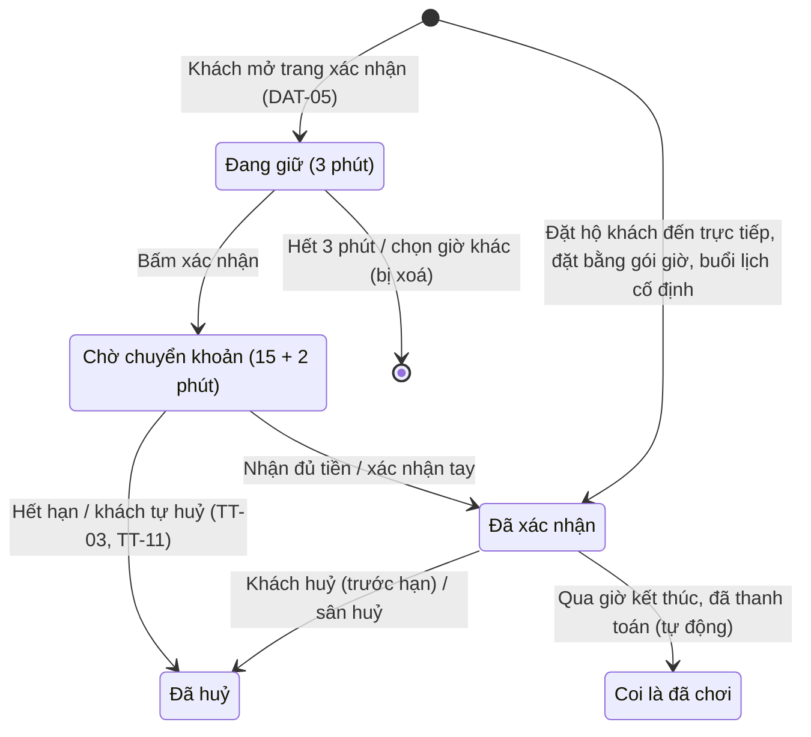
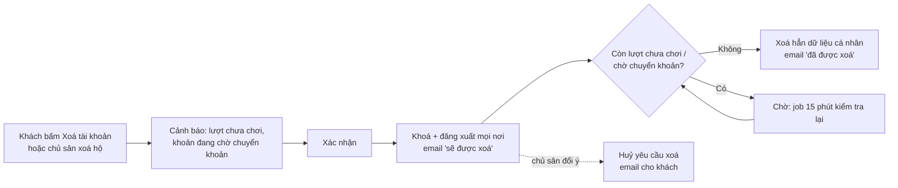
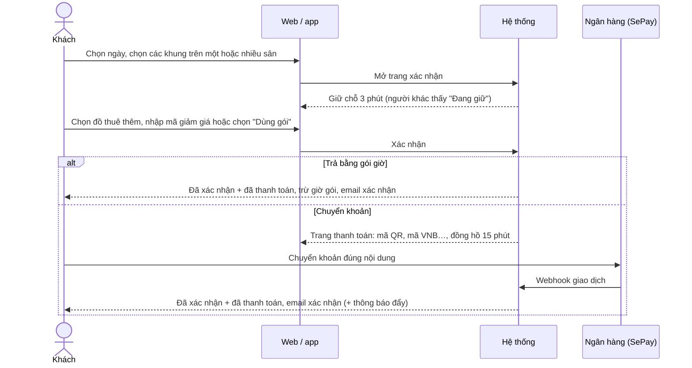
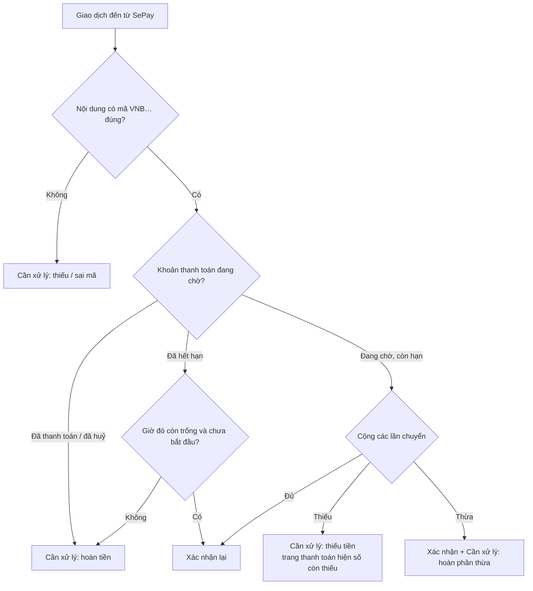
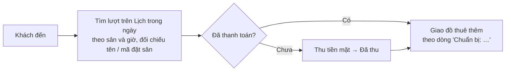
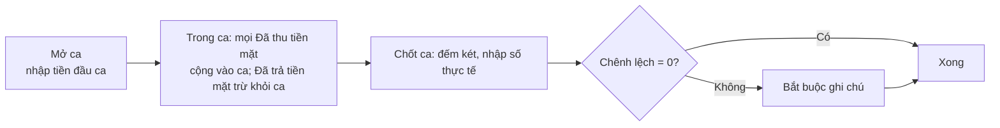
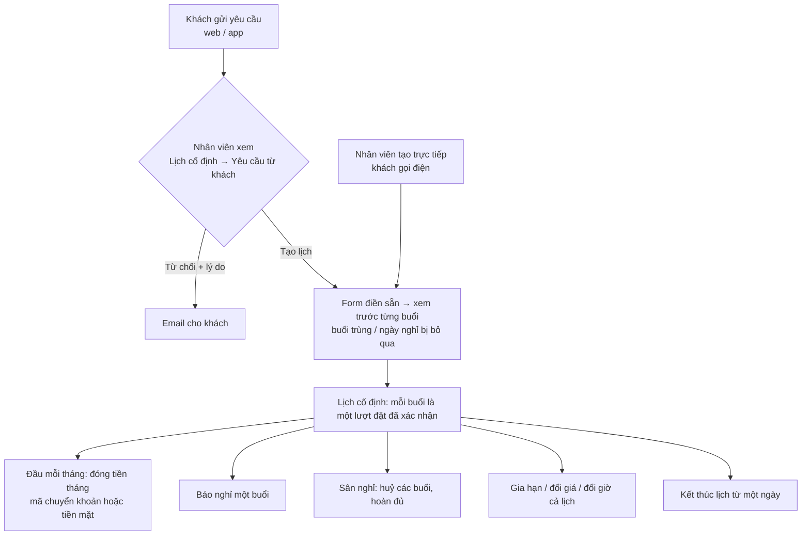
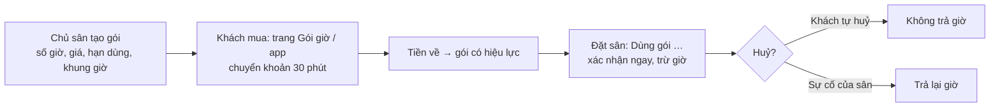
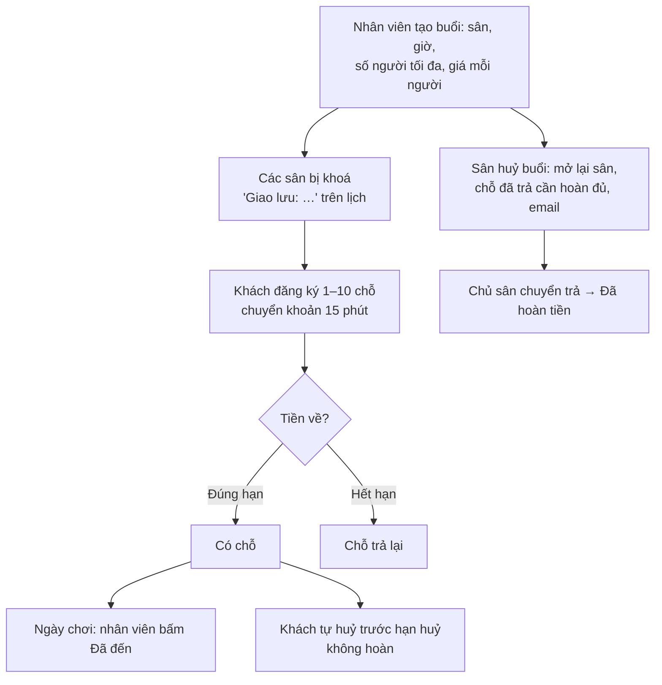
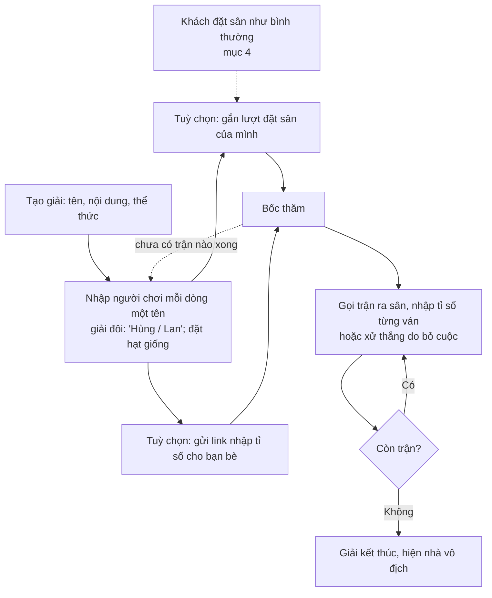

# Quy trình nghiệp vụ – VN Badminton

Tài liệu này mô tả **từng quy trình** của web đặt sân: ai làm gì, theo thứ tự nào, hệ thống tự làm gì, và xử lý thế nào khi
có ngoại lệ. Dùng để **đào tạo nhân viên**, **kiểm thử** và **phát triển** tính năng mới.

- **Quy tắc** (con số, giới hạn, điều kiện) nằm ở [`business-rules.md`](business-rules.md); ở đây chỉ dẫn **mã quy tắc**
  trong ngoặc, ví dụ (DAT-05), để không viết hai lần. Nếu hai tài liệu khác nhau thì **quy tắc và test đúng**, sửa tài liệu này.
- PR nào đổi một quy trình thì sửa luôn mục tương ứng ở đây, như với `business-rules.md` (xem `CLAUDE.md`).
- Các con số đánh dấu ⚙️ chỉnh được trong **Quản lý → Hệ thống → Cài đặt**; số ghi ở đây là mặc định.
- App Android (Flutter) dùng **cùng quy trình** cho mọi việc của khách (AP-03); việc của chủ sân/nhân viên **chỉ có trên web** (AP-01).

> Cập nhật: 24/10/2026, theo `main` sau PR #31, cộng nhánh `bug-fixes`: bỏ Nhận sân / Không đến.

---

## Mục lục

1. [Vai trò và màn hình](#1-vai-trò-và-màn-hình)
2. [Thiết lập ban đầu (chủ sân)](#2-thiết-lập-ban-đầu-chủ-sân)
3. [Tài khoản](#3-tài-khoản)
4. [Đặt sân online](#4-đặt-sân-online)
5. [Thanh toán chuyển khoản và xử lý giao dịch](#5-thanh-toán-chuyển-khoản-và-xử-lý-giao-dịch)
6. [Huỷ, đổi giờ, sự cố của sân và hoàn tiền](#6-huỷ-đổi-giờ-sự-cố-của-sân-và-hoàn-tiền)
7. [Đặt hộ và khoá sân (nhân viên)](#7-đặt-hộ-và-khoá-sân-nhân-viên)
8. [Vận hành tại quầy và ca làm](#8-vận-hành-tại-quầy-và-ca-làm)
9. [Lịch cố định hằng tuần](#9-lịch-cố-định-hằng-tuần)
10. [Ưu đãi: hạng thành viên, mã giảm giá, gói giờ](#10-ưu-đãi-hạng-thành-viên-mã-giảm-giá-gói-giờ)
11. [Đồ thuê thêm](#11-đồ-thuê-thêm)
12. [Giao lưu (vãng lai)](#12-giao-lưu-vãng-lai)
13. [Nhóm](#13-nhóm)
14. [Giải đấu nội bộ (công cụ của khách)](#14-giải-đấu-nội-bộ-công-cụ-của-khách)
15. [Tiện ích khác cho khách](#15-tiện-ích-khác-cho-khách)
16. [Khách hàng, danh sách đen, khoá đặt online](#16-khách-hàng-danh-sách-đen-khoá-đặt-online)
17. [Báo cáo và cuối tháng](#17-báo-cáo-và-cuối-tháng)
18. [Thông báo cho khách (email, thông báo đẩy)](#18-thông-báo-cho-khách-email-thông-báo-đẩy)
19. [Việc hệ thống tự làm](#19-việc-hệ-thống-tự-làm)
20. [Danh sách kiểm tra theo ngày, ca, tháng](#20-danh-sách-kiểm-tra-theo-ngày-ca-tháng)

---

## 1. Vai trò và màn hình

| Vai trò | Là ai | Làm ở đâu |
|---------|-------|-----------|
| **Khách** | Người đặt sân, có tài khoản (số điện thoại bắt buộc) | Web: **Đặt sân**, **Lượt đặt của tôi**, **Giao lưu**, **Giải đấu**, trang tài khoản; app Android |
| **Khách vãng lai** | Gọi điện hoặc đến trực tiếp, có thể không có tài khoản | Không tự thao tác; nhân viên đặt hộ (mục 7) |
| **Nhân viên** | Tài khoản được chủ sân cấp quyền (TK-05) | Web: **Quản lý → Vận hành** |
| **Chủ sân** | Một tài khoản `admin` | Web: **Quản lý** đủ bốn nhóm: **Vận hành**, **Bán hàng**, **Thu chi**, **Hệ thống** |
| **Hệ thống** | Job nền, webhook ngân hàng (SePay) | Tự động (mục 19) |

Menu **Quản lý** (phân quyền chi tiết: mục 9 của `business-rules.md`):

| Nhóm | Trang | Nhân viên | Chủ sân |
|------|-------|-----------|---------|
| Vận hành | Lịch trong ngày, Lịch cố định, Giao lưu, Khách hàng, Ca làm, Đánh giá | ✓ | ✓ |
| Bán hàng | Bảng giá, Gói giờ, Đồ thuê thêm, Mã giảm giá | | ✓ |
| Thu chi | Giao dịch, Báo cáo, Báo cáo khách | | ✓ |
| Hệ thống | Bảng tin, Nhân viên, Cài đặt | | ✓ |

**Trạng thái của một lượt đặt sân** (dùng xuyên suốt tài liệu):

Nhân viên **không ghi nhận** khách đến hay không đến (VH-04): lượt **không huỷ, đã qua giờ** tự được coi là **đã chơi**:
khách đánh giá được (TI-03), và nếu **đã thanh toán** thì được tính vào hạng thành viên (UD-01). Lượt cũ đã ghi "Đã nhận sân" / "Không đến" trước 24/10/2026 vẫn hiện như cũ.

Song song với trạng thái, mỗi lượt có **tình trạng tiền**: *chưa thanh toán* → *đã thanh toán* (chuyển khoản tự xác nhận,
xác nhận tay, hoặc **Đã thu** tiền mặt) → *đã hoàn* (chỉ khi sân có lỗi, TT-07). Mọi thay đổi được ghi vào **Lịch sử lượt
đặt** kèm người làm và thời điểm (VH-11).

---

## 2. Thiết lập ban đầu (chủ sân)

Làm một lần khi mở web, rồi chỉnh khi cần. Tất cả ở **Quản lý** (chỉ chủ sân).

| Bước | Trang | Việc | Quy tắc |
|------|-------|------|---------|
| 1 | Hệ thống → **Cài đặt** | Giờ mở cửa từng ngày trong tuần (ngày trống = nghỉ); số ngày đặt trước, thời lượng tối thiểu/tối đa, số lượt sắp tới mỗi khách, hạn huỷ, giới hạn huỷ và thời gian khoá | CS-03, DAT-02..04, HUY-01, HUY-03 ⚙️ |
| 2 | Hệ thống → **Cài đặt** | **Tài khoản ngân hàng** của sân (ngân hàng, số tài khoản, chủ tài khoản; đã kết nối SePay). Chưa nhập thì **không đặt online và không đặt hộ qua điện thoại được** | TT-01 |
| 3 | Hệ thống → **Cài đặt** | Số Zalo, Fanpage cho nút **Liên hệ**; hạng thành viên (bật/tắt, mức giờ, mức giảm) | CS-05, UD-01 ⚙️ |
| 4 | Bán hàng → **Bảng giá** | Các khung giá (giá/giờ, ngày trong tuần, từ ngày–đến ngày, sân riêng, độ ưu tiên). **Khung giờ không có giá thì không đặt được** | GIA-01..05 |
| 5 | Hệ thống → **Nhân viên** | Nhân viên tự đăng ký tài khoản trước, chủ sân nhập email/số điện thoại của họ để cấp quyền | mục 9 |
| 6 | Bán hàng → Đồ thuê thêm, Gói giờ, Mã giảm giá; Hệ thống → Bảng tin | Tuỳ chọn, xem các mục 10, 11, 15 | TI-01, UD-02, UD-04, TI-02 |

Cấu hình máy chủ (không làm trên web): khoá webhook SePay, Firebase cho thông báo đẩy, Google client ID, vân tay khoá ký
app (BM-06, TB-04, AP-04, AP-05). Bí mật không bao giờ nằm trong repo (BM-04).

---

## 3. Tài khoản

### 3.1 Đăng ký và xác minh email
1. Khách vào **Đăng ký**: họ tên, số điện thoại, email, mật khẩu, tick đồng ý chính sách bảo mật (TK-01).
   Hoặc bấm **Tiếp tục với Google** (AP-05): người mới nhập thêm số điện thoại và tick đồng ý trong 15 phút.
2. Hệ thống gửi **email xác minh** (EM-01; Google: email coi như đã xác minh).
3. Chưa xác minh: xem lịch được, **không đặt được**; thanh nhắc có nút **gửi lại** (TK-03, giới hạn BM-01).

### 3.2 Đăng nhập, hết phiên, quên mật khẩu
- Đăng nhập bằng email **hoặc** số điện thoại (TK-02), hoặc Google. Sai nhiều lần → tạm chặn (BM-01).
- **30 phút không thao tác** → tự đăng xuất, trang tự chuyển về đăng nhập (TK-06).
- Quên mật khẩu → email đặt lại (EM-06). Tài khoản tạo bằng Google đặt mật khẩu theo cách này.

### 3.3 Hồ sơ, tải dữ liệu
- Trang tài khoản: sửa thông tin, hồ sơ tuỳ chọn (ảnh, năm sinh, giới tính, trình độ, TK-10), xem **hạng thành viên** (UD-01).
- **Tải dữ liệu của tôi**: nhập lại mật khẩu → file JSON (TK-07).

### 3.4 Xoá tài khoản

- Khách tự xoá (nhập lại mật khẩu); chủ sân xoá khách hoặc nhân viên; nhân viên không xoá người khác; tài khoản chủ sân không xoá được (TK-08).
- Khi xoá hẳn (TK-09): giữ lượt đặt/thanh toán dưới tên "Khách đã xoá tài khoản"; rời mọi nhóm (NH-03); **xoá các giải đấu mình tạo** (GD-01); giữ ghi chú nếu khách đang bị chặn.

### 3.5 Cấp quyền nhân viên
1. Nhân viên tự đăng ký tài khoản như khách.
2. Chủ sân vào **Hệ thống → Nhân viên**, nhập email hoặc số điện thoại → tài khoản thành nhân viên.
3. Nhân viên nghỉ: chủ sân **gỡ quyền** ở trang Nhân viên (tài khoản trở lại là khách) hoặc xoá tài khoản; lịch sử vẫn giữ tên họ (TK-09).

---

## 4. Đặt sân online

**Ai:** khách đã đăng nhập, email đã xác minh, không trong danh sách đen, không bị khoá (DAT-01, DAT-08).

### 4.1 Các bước
1. **Chọn giờ** (trang **Đặt sân**): xem lịch không cần đăng nhập; chọn trong 14 ngày tới, ngày sân mở (DAT-02). Mỗi sân
   một khoảng liên tục 60–240 phút; nhiều sân cùng lúc được (DAT-03). Ô "Đang giữ" / đã đặt không chọn được.
2. **Trang xác nhận**: hệ thống **giữ chỗ 3 phút** (DAT-05). Khách xem tổng tiền (giá theo khung, GIA-01), chọn:
   - **Đồ thuê thêm** (TI-01), tổng tiền cập nhật ngay;
   - **Mã giảm giá** hoặc để **ưu đãi hạng** tự áp dụng; hệ thống lấy mức có lợi hơn (UD-03);
   - hoặc **Dùng gói …** nếu có gói trả được các khung đã chọn (UD-05; không chọn đồ thuê được).
3. **Xác nhận**:
   - Trả bằng gói → lượt **đã xác nhận, đã thanh toán** ngay.
   - Còn lại → lượt **chờ chuyển khoản 15 phút** (DAT-07), mở trang thanh toán (mục 5).
4. Nhận đủ tiền → **đã xác nhận + đã thanh toán**, email xác nhận (một email cho nhiều sân), thông báo đẩy nếu dùng app.
5. **3 giờ trước giờ chơi**: email nhắc lịch (EM-04).
6. Đến sân và chơi; khách đến trực tiếp chưa trả thì nhân viên thu tiền mặt (mục 8). Không cần ghi nhận khách đã đến.

### 4.2 Ngoại lệ
| Tình huống | Hệ thống làm | Quy tắc |
|------------|--------------|---------|
| Hai người chọn cùng khung cùng lúc | Chỉ một người được, người kia thấy "Khung giờ này đã có người đặt" | DAT-09 |
| Quá 3 phút ở trang xác nhận | Vẫn xác nhận được nếu chưa ai lấy; tải lại trang không gia hạn | DAT-05 |
| Đã có 2 lượt sắp tới | Không cho đặt thêm (buổi lịch cố định không tính) | DAT-04 |
| Bấm thanh toán hai lần / quay lại | Lượt chờ chuyển khoản trước bị thay thế, mã cũ huỷ | TT-05 |
| Mã giảm giá không dùng được | Không đặt, báo lý do (kể cả giảm làm tròn còn 0đ) | UD-02 |
| Món đồ thuê vừa ngừng bán | Báo chọn lại, không đặt gì | TI-01 |
| Sân chưa nhập tài khoản ngân hàng | Không đặt online được | TT-01 |
| Mở trang xác nhận quá nhiều lần | Tạm chặn (chống giữ chỗ hàng loạt) | DAT-06 |
| Sân đã kín giờ khách muốn | Khách bấm ô đó để **chờ sân trống** (mục 15.1) | TI-04 |

---

## 5. Thanh toán chuyển khoản và xử lý giao dịch

Mọi khoản thu online đi qua **một khoản thanh toán** có mã riêng `VNB` + 8 ký tự (TT-02): đặt sân, đặt hộ qua điện thoại,
tháng lịch cố định, gói giờ, chỗ giao lưu.

### 5.1 Khách chuyển khoản
1. Trang thanh toán hiện **mã QR** (số tài khoản, số tiền, nội dung), thông tin chuyển tay, nút **Lưu ảnh QR**, đồng hồ.
2. Khách chuyển **đúng nội dung** (mã VNB…). Nhiều sân trong một lần đặt = một lần chuyển.
3. Ngân hàng báo qua **webhook SePay** (BM-06) → hệ thống cộng các lần chuyển có mã đúng (TT-04).
4. Trang thanh toán **tự cập nhật** khi nhận tiền hoặc hết hạn.
5. Khách đổi ý trước khi chuyển: bấm **Huỷ đặt sân / Huỷ giữ chỗ** → mở lại ngay, trả lượt mã giảm giá (TT-11).

### 5.2 Hệ thống xử lý một giao dịch đến

### 5.3 Chủ sân xử lý "Cần xử lý" (Thu chi → **Giao dịch**)
| Loại | Việc cần làm | Quy tắc |
|------|--------------|---------|
| **Thiếu tiền** | Chờ khách chuyển thêm cùng nội dung (tự xác nhận khi đủ), hoặc liên hệ khách | TT-04 |
| **Thừa tiền** | Chuyển trả phần thừa cho khách bằng tay | TT-04 |
| **Thiếu / sai mã** | Hỏi khách, **gán giao dịch vào đơn** bằng mã VNB… hoặc mã đặt sân → xử lý như có mã đúng | TT-10 |
| **Trễ hạn, giờ đã có người lấy** / **đơn đã huỷ** / **đã thanh toán rồi** | Chuyển trả lại cho khách | TT-04, TT-09 |

**Xác nhận tay** (nhân viên hoặc chủ sân, trên lượt đang chờ chuyển khoản): khi đã thấy tiền trong tài khoản ngân hàng mà
hệ thống chưa nhận (webhook chậm). Theo cùng quy tắc chuyển trễ (TT-06, TT-09).

---

## 6. Huỷ, đổi giờ, sự cố của sân và hoàn tiền

### 6.1 Khách tự huỷ
1. **Lượt đặt của tôi** → lượt → **Huỷ** (tới 2 giờ trước giờ chơi ⚙️; sau đó phải gọi sân) (HUY-01).
2. Lượt đã trả tiền: cảnh báo **không hoàn tiền**; lượt trả bằng gói: **không trả giờ** (UD-06).
3. Lần huỷ thứ 3 trong ngày: cảnh báo trước, xác nhận thì **khoá đặt online 7 ngày** ⚙️ (HUY-03).
4. Giờ đó trống lại ngay; email huỷ (EM-03); khách đang chờ khung đó được báo (TI-04).

### 6.2 Khách tự đổi giờ
1. Lượt đặt → **Đổi giờ** → lịch ở chế độ đổi giờ (giờ cũ chọn lại được, một sân) (DOI-02).
2. Chọn khung mới → xem giờ cũ / giờ mới / giá mới → xác nhận.
3. Điều kiện: trước hạn huỷ, theo quy định online; lượt **đã trả**: chỉ sang khung **không đắt hơn**, không hoàn chênh lệch
   (DOI-01). Khung đắt hơn → gọi sân.
4. Hệ thống tính lại giá, gửi lại nhắc lịch theo giờ mới, email đổi giờ (DOI-04).

### 6.3 Sân huỷ hoặc đổi giờ (nhân viên, chủ sân)
- **Lịch trong ngày** → lượt → **Huỷ** (bất cứ lúc nào trước giờ kết thúc, VH-09) hoặc **Đổi giờ** (không theo quy định online,
  vẫn theo giờ mở cửa, DOI-03). Khách nhận email huỷ (xin lỗi + số điện thoại sân) hoặc email đổi giờ.
- Huỷ thường **không ghi nợ hoàn tiền**; nếu là lỗi của sân, dùng **Huỷ do sự cố của sân** (6.4).

### 6.4 Sự cố của sân và hoàn tiền (chỉ khi lỗi thuộc về sân)
1. Nhân viên bấm **Huỷ do sự cố của sân** (chỉ trong ngày của lượt đặt, VH-09).
2. Hệ thống:
   - lượt đã trả bằng tiền → ghi **cần hoàn đủ số khách đã trả** (cả đồ thuê thêm) (TT-07, UD-03);
   - lượt trả bằng gói → **trả lại giờ** vào gói, không hoàn tiền (UD-06);
   - email huỷ + thông báo đẩy.
3. Chủ sân trả tiền cho khách, rồi bấm:
   - **Đã chuyển khoản trả** — không ảnh hưởng ca làm;
   - **Đã trả tiền mặt** — **trừ** khỏi ca đang mở (VH-12).

Khách tự huỷ **không bao giờ** được hoàn. Lịch cố định hoàn theo cách riêng (mục 9.4).

---

## 7. Đặt hộ và khoá sân (nhân viên)

### 7.1 Đặt hộ
1. **Lịch trong ngày** → bấm ô trống → form đặt hộ: sân, giờ, tên, **số điện thoại** khách. Số trùng tài khoản → lượt gắn
   vào tài khoản đó (VH-02). Khách trong danh sách đen → có cảnh báo, vẫn đặt được (VH-06).
2. Chọn cách trả:
   - **Khách gọi điện**: **chuyển khoản 100%**, sân **giữ 15 phút**; nhân viên gửi **link thanh toán / mã QR** cho khách
     (Zalo, tin nhắn). Tiền về → tự xác nhận (mục 5).
   - **Khách đến trực tiếp**: trả **tiền mặt**, lượt **xác nhận ngay**; nhân viên bấm **Đã thu** khi nhận tiền (mục 8).
3. Không theo quy định online (thời lượng, số ngày trước…), vẫn theo giờ mở cửa. Không áp dụng ưu đãi (UD-03).
4. Khách có tài khoản nhận email xác nhận (EM-02).

### 7.2 Khoá sân
- Bảo trì, sự kiện, sơn sân: **Lịch trong ngày** → ô trống → **Khoá sân** (bất kỳ giờ nào, ghi chú lý do). Gỡ khoá bất cứ lúc
  nào. Không giá, không khách, không email (VH-03).
- Buổi giao lưu tự khoá sân của nó (mục 12); giải đấu của khách **không** khoá sân (mục 14).

---

## 8. Vận hành tại quầy và ca làm

### 8.1 Một lượt khách đến sân

- **Không có** bước "Nhận sân" hay "Không đến": khách đã trả trước, đến hay không không ảnh hưởng tiền (VH-04).
- **Đã thu** hoàn tác được khi bấm nhầm (**Huỷ "đã thu"**); sau giờ kết thúc vẫn thu được (VH-09).
- Hai người cùng thao tác một lượt: người sau thấy "Lượt đặt vừa được cập nhật ở nơi khác", tải lại rồi làm tiếp (VH-05).
- Lịch tự cập nhật khi có đặt/huỷ/giữ chỗ (VH-08); mục **Khách đang giữ chỗ** trên trang Đặt sân để gọi khách khi cần (VH-10).

### 8.2 Ca làm (tiền mặt trong két)

1. Đầu ca: **Vận hành → Ca làm → Mở ca**, nhập tiền đầu ca (ô điền sẵn số đếm của ca trước). Mỗi lúc chỉ **một** ca mở.
2. Trong ca: tiền mặt thu bằng **Đã thu** (lượt đặt, tháng lịch cố định) được tính vào ca; **Đã trả tiền mặt** (hoàn do sự
   cố) bị trừ; huỷ "đã thu" trong cùng ca trừ lại đúng số đó. Chuyển khoản không tính.
3. Cuối ca: **Chốt ca**, đếm két, nhập số thực tế. **Nhân viên đếm mù**: không thấy số dự kiến trước khi chốt.
4. Hệ thống tính chênh lệch = đếm được − (đầu ca + tiền mặt thu trong ca). Khác 0 thì phải ghi chú.
5. Chủ sân xem **lịch sử chốt ca theo tháng** và từng khoản thu của mỗi ca (VH-12).

> Thu tiền khi **chưa mở ca** thì không thuộc ca nào: luôn mở ca trước khi thu.

---

## 9. Lịch cố định hằng tuần

Khách chơi cố định (ví dụ thứ 3, thứ 5 hằng tuần) đóng tiền **theo tháng dương lịch**.

### 9.1 Tạo lịch
1. Khách gửi **yêu cầu** (Lượt đặt của tôi → Lịch cố định → **Xin lịch mới**, tối đa 3 yêu cầu chờ) **hoặc** gọi sân (CD-09).
2. Nhân viên: **Lịch cố định → Yêu cầu từ khách** → **Tạo lịch** (form điền sẵn) hoặc **Từ chối** kèm lý do; khách nhận email (EM-08).
3. Form tạo (CD-01): khách, sân, các ngày trong tuần, khung giờ, từ ngày–đến ngày (≤ 1 năm), **giá riêng** (trống = bảng giá).
4. **Xem trước từng buổi**; buổi trùng người khác, ngày nghỉ, ngoài giờ mở cửa **bị bỏ qua** (CD-02) → xác nhận.

### 9.2 Đóng tiền tháng
1. Cần thu = tiền các buổi trong tháng − tiền hoàn từ các tháng trước (CD-03, CD-07).
2. Hai cách:
   - **Chuyển khoản**: nhân viên bấm **Gửi mã chuyển khoản** hoặc khách tự bấm đóng (web/app, CD-10) → mã VNB… cho số cần
     đóng → tiền về tự ghi nhận;
   - **Tiền mặt**: nhân viên bấm **Đã thu** (tính vào ca, mục 8.2).
3. Đã thu → mọi buổi trong tháng thành "Đã thanh toán".

### 9.3 Báo nghỉ một buổi
- Khách (trên web, trước hạn huỷ) hoặc nhân viên huỷ buổi đó → giờ trống cho người khác; không tính vào giới hạn huỷ (CD-04).

### 9.4 Hoàn tiền buổi báo nghỉ, sân nghỉ
- **Buổi khách báo nghỉ**: sau giờ chơi, hệ thống tự xét: hoàn **theo tỷ lệ phần giờ có người khác đặt và đã chơi**; không ai
  đặt → sân giữ tiền; tháng chưa đóng → không tính nên không hoàn (CD-05).
- **Sân nghỉ** (lễ, sửa chữa): chọn khoảng ngày → huỷ các buổi, **hoàn đủ** (tháng đã đóng) (CD-06).
- Tiền hoàn **không trả bằng tiền**: trừ vào **tháng kế tiếp chưa đóng** (CD-07).

### 9.5 Thay đổi lịch
| Việc | Cách làm | Quy tắc |
|------|----------|---------|
| Gia hạn | Chọn ngày kết thúc mới, xem trước như lúc tạo | CD-08 |
| Đổi giá riêng | Chỉ tính lại buổi chưa chơi thuộc tháng chưa đóng | CD-08 |
| Đổi giờ một buổi | Nhân viên đổi giờ lượt đó như lượt thường (khách không tự đổi) | CD-08 |
| **Đổi giờ cả lịch** | **Đổi giờ…** → ngày áp dụng, sân/ngày/giờ mới → xem trước; buổi bị trùng chọn **giữ giờ cũ** hoặc **sân khác còn trống** → xác nhận; tháng đã đóng giữ nguyên tiền; khách nhận email (EM-10) | CD-11 |
| Kết thúc lịch | Chọn ngày → huỷ các buổi còn lại, **không hoàn** | CD-06 |

---

## 10. Ưu đãi: hạng thành viên, mã giảm giá, gói giờ

**Mỗi đơn một ưu đãi**, lấy mức có lợi hơn cho khách; ưu đãi **chỉ giảm tiền sân**; không áp dụng cho đặt hộ, lịch cố định,
giao lưu (UD-03, GL-04).

### 10.1 Hạng thành viên (tự động)
- Hệ thống tính số giờ đã chơi trong 12 tháng (lượt đã thanh toán, không huỷ, đã qua giờ) → hạng Đồng / Bạc / Vàng / Kim cương ⚙️
  → tự giảm khi khách đặt online (UD-01). Khách xem hạng ở trang tài khoản; nhân viên xem ở trang khách.

### 10.2 Mã giảm giá (chủ sân)
1. **Bán hàng → Mã giảm giá → Tạo**: % (giảm tối đa) hoặc số tiền, thời gian, ngày trong tuần, khung giờ, đơn tối thiểu,
   tổng số lượt, số lượt mỗi khách (UD-02).
2. Gửi mã cho khách (Zalo, Fanpage, gọi khách quen lâu không đến: mục 17.2).
3. Khách nhập mã ở bước xác nhận. Lượt dùng tính khi đơn chờ chuyển khoản hoặc đã trả; hết hạn / khách tự huỷ → trả lượt.
4. Mã đã có người dùng thì **tắt**, không xoá.

### 10.3 Gói giờ

- Giờ trong gói **không hoàn tiền** (UD-06). Báo cáo tháng ghi tiền bán gói riêng (UD-04).

---

## 11. Đồ thuê thêm

1. Chủ sân: **Bán hàng → Đồ thuê thêm** — tạo món (tên vi/en, giá, thứ tự, đang bán); món đã có người chọn thì **tắt** (TI-01).
2. Khách chọn món và số lượng ở bước xác nhận (web/app); tiền cộng vào khoản chuyển khoản. Trả bằng gói thì không chọn được (thuê tại quầy).
3. **Lịch trong ngày** hiện **"Chuẩn bị: …"** trên lượt sớm nhất của lần đặt → nhân viên chuẩn bị và giao khi khách đến.
4. Khách tự huỷ: không hoàn; sự cố của sân: hoàn cả tiền đồ.

---

## 12. Giao lưu (vãng lai)

Buổi chơi chung do sân tổ chức, khách mua **chỗ** theo người.

- Tạo: **Vận hành → Giao lưu** (GL-01). Sân đã có người đặt thì không tạo được.
- Khách đăng ký trên trang **Giao lưu** hoặc app; tiền về trễ chỉ nhận khi còn chỗ (GL-02).
- Hoàn tiền chỗ giao lưu luôn bằng **chuyển khoản**, chỉ chủ sân ghi nhận (GL-03, VH-12).

---

## 13. Nhóm

Công cụ cho khách chơi cùng nhau chia tiền; **sân không thu hộ** (NH-01..03).

1. Khách tạo nhóm (**Lượt đặt của tôi → Nhóm** hoặc app) → nhận **mã nhóm 6 ký tự** → gửi bạn bè.
2. Bạn bè nhập mã để vào nhóm (tối đa 20 người; mỗi người tối đa 10 nhóm). Thành viên chỉ thấy họ tên nhau.
3. Thành viên **chia sẻ lượt đặt** của mình vào nhóm, chọn số người chơi → cả nhóm thấy sân, giờ, **mỗi người góp** (làm tròn lên nghìn).
4. Rời nhóm: lượt mình chia sẻ bị gỡ; chủ nhóm rời → nhóm chuyển cho thành viên vào sớm nhất.

---

## 14. Giải đấu nội bộ (công cụ của khách)

Khách tự tổ chức giải cho nhóm mình. **Sân không tham gia**: không trang quản lý, không lệ phí, không khoá sân (mục 19 của
`business-rules.md`).

1. **Tạo** (trang **Giải đấu của tôi**, web/app): chọn thể thức; mỗi thể thức có giải thích chi tiết (nút **i**) (GD-01, GD-04).
2. **Người chơi**: gõ danh sách, sai một dòng thì không thêm gì và báo dòng nào; sửa tên, hạt giống, xoá trước bốc thăm (GD-03).
3. **Sân** (tuỳ chọn): gắn các lượt đặt đã xác nhận của mình → trang giải hiện sân/giờ, chọn được sân cho từng trận (GD-05).
4. **Người nhập tỉ số** (tuỳ chọn): gửi link; bạn bè đăng nhập, bấm **Nhận quyền nhập tỉ số**; bỏ quyền hoặc tạo link mới khi cần (GD-02).
5. **Bốc thăm** → các trận được tạo; **bốc thăm lại** được khi chưa có trận nào xong (GD-04).
6. **Nhập kết quả**: người thắng tự vào trận sau; vòng bảng xong tự tạo vòng loại trực tiếp; sửa kết quả khi trận sau chưa đấu (GD-06, GD-07).
7. **Chia sẻ**: nút **Gửi link giải**; ai có link xem được bảng xếp hạng, sơ đồ, nhà vô địch (GD-01).

---

## 15. Tiện ích khác cho khách

### 15.1 Chờ sân trống
1. Trên **Đặt sân**, khách bấm ô đã có người đặt/giữ → chọn chờ khung đó (tối đa 5 khung) (TI-04).
2. Khi một lượt chồng khung đó bị huỷ, hết hạn chuyển khoản, đổi giờ đi hoặc bỏ giữ chỗ, và có một sân trống trọn khung →
   **mọi người đang chờ** nhận email (EM-07) + thông báo đẩy; ai đặt trước được trước.
3. Xem và bỏ chờ ở **Lượt đặt của tôi**.

### 15.2 Đánh giá buổi chơi
- Sau giờ kết thúc, trong 14 ngày, lượt **không bị huỷ**: khách đánh giá 1–5 sao + góp ý, một lần (TI-03).
- Nhân viên/chủ sân xem ở **Vận hành → Đánh giá**.

### 15.3 Bảng tin
- Chủ sân đăng tin (thông tin / ưu đãi / lưu ý) hiện từ ngày–đến ngày trên trang **Đặt sân** và trong app; xoá nhiều tin một lần (TI-02).
- Không dùng thông báo đẩy cho quảng cáo (TB-02).

---

## 16. Khách hàng, danh sách đen, khoá đặt online

- **Vận hành → Khách hàng**: khách định danh theo **số điện thoại** (có hoặc không có tài khoản): lịch sử, thống kê, hạng,
  **ghi chú riêng** (khách không thấy) (VH-06).
- **Danh sách đen**: thêm khi khách bỏ sân nhiều lần, gây rối… → khách không đặt online, không đăng ký giao lưu; nhân viên
  vẫn đặt hộ được (có cảnh báo). Bỏ khỏi danh sách đen bất cứ lúc nào.
- **Khoá đặt online 7 ngày** (tự động, HUY-03): nhân viên/chủ sân **mở khoá sớm** ở trang khách khi có lý do.

---

## 17. Báo cáo và cuối tháng

### 17.1 Báo cáo tháng (Thu chi → **Báo cáo**)
Doanh thu dự kiến / đã thu, số lượt, tỷ lệ lấp đầy, so với tháng trước, biểu đồ theo ngày và theo thứ × giờ, tiền bán gói giờ
và chỗ giao lưu ghi riêng; **xuất CSV** cho kế toán (VH-07).

### 17.2 Báo cáo khách (Thu chi → **Báo cáo khách**)
Top khách chơi nhiều / chi nhiều; **khách quen lâu không quay lại** (gọi hỏi thăm, gửi mã giảm giá) (VH-13).

### 17.3 Việc cuối tháng của chủ sân
1. Đối chiếu **Báo cáo tháng** (đã thu) với sao kê ngân hàng và **lịch sử chốt ca** (tiền mặt).
2. Xử lý hết **Giao dịch → Cần xử lý** và các khoản **cần hoàn** (sự cố của sân, giao lưu bị huỷ).
3. Nhắc khách lịch cố định đóng tiền tháng mới (mục 9.2).
4. Xem Báo cáo khách: gửi mã giảm giá cho khách lâu không quay lại.
5. Cập nhật bảng giá, bảng tin, mã giảm giá cho tháng sau nếu cần.

---

## 18. Thông báo cho khách (email, thông báo đẩy)

Email gửi cho khách có tài khoản, theo ngôn ngữ của khách (TK-04); người dùng app nhận thêm **thông báo đẩy** cho việc do
**sân hoặc hệ thống** làm (TB-02). Chủ sân **không** nhận email.

| Sự kiện | Email | Thông báo đẩy |
|---------|-------|---------------|
| Đăng ký / đổi email | Xác minh (EM-01) | |
| Đặt sân được xác nhận (tiền về, xác nhận tay, đặt hộ) | Xác nhận (EM-02) | ✓ |
| 3 giờ trước giờ chơi | Nhắc lịch (EM-04) | ✓ |
| Khách tự huỷ | Xác nhận huỷ (EM-03) | |
| Sân huỷ / huỷ do sự cố | Huỷ, xin lỗi (EM-03) | ✓ |
| Đổi giờ (khách / sân) | Đổi giờ (EM-05) | ✓ khi sân đổi |
| Quên mật khẩu | Đặt lại (EM-06) | |
| Có sân trống | EM-07 | ✓ |
| Trả lời yêu cầu lịch cố định | EM-08 | ✓ |
| Sân đổi giờ cả lịch cố định | EM-10 | ✓ |
| Sân huỷ buổi giao lưu | EM-09 | ✓ |
| Nhận đủ tiền gói giờ / chỗ giao lưu / tháng lịch cố định | | ✓ |
| Xoá tài khoản (yêu cầu, huỷ yêu cầu, đã xoá) | ✓ (TK-09) | |

---

## 19. Việc hệ thống tự làm

| Việc | Khi nào | Kết quả | Quy tắc |
|------|---------|---------|---------|
| Nhả giữ chỗ hết hạn | Đúng lúc hết 3 phút; dọn lại mỗi 15 phút | Khung trống lại, lịch đang mở tự cập nhật | DAT-05 |
| Huỷ lượt hết hạn chuyển khoản | Sau 15 + 2 phút | Lượt huỷ ("hết hạn thanh toán"), trả lượt mã giảm giá | TT-03 |
| Nhận giao dịch ngân hàng | Mỗi webhook SePay | Xác nhận hoặc đưa vào "Cần xử lý" | TT-04, TT-09, TT-10 |
| Nhắc lịch | Mỗi 10 phút | Email + thông báo đẩy 3 giờ trước giờ chơi | EM-04 |
| Báo sân trống | Khi một lượt/giữ chỗ nhả sân | Email + thông báo đẩy cho người đang chờ | TI-04 |
| Hoàn tiền buổi lịch cố định báo nghỉ | Mỗi 15 phút (sau giờ chơi) | Ghi khoản hoàn, trừ vào tháng sau | CD-05 |
| Xoá hẳn tài khoản | Mỗi 15 phút | Xoá dữ liệu cá nhân khi không còn gì đang chờ | TK-09 |
| Gửi thông báo đẩy | Mỗi thông báo, mỗi máy | Thử lại 3 lần; xoá token không còn dùng | TB-04 |

Chi tiết lịch chạy: mục 12 của `business-rules.md` và `config/recurring.yml`.

---

## 20. Danh sách kiểm tra theo ngày, ca, tháng

**Đầu ca (nhân viên)**
- [ ] Đăng nhập, **Mở ca** với số tiền đếm được trong két.
- [ ] Xem **Lịch trong ngày**: lượt sắp đến, dòng **"Chuẩn bị: …"** (đồ thuê thêm), buổi giao lưu, sân bị khoá.

**Trong ca**
- [ ] Khách đến: tìm lượt theo sân và giờ → thu tiền mặt nếu chưa trả (**Đã thu**) → giao đồ thuê thêm.
- [ ] Khách gọi đặt: **đặt hộ** chuyển khoản, gửi link thanh toán; khách tại quầy: đặt hộ tiền mặt.
- [ ] Sự cố (mất điện, sân hỏng): **Huỷ do sự cố của sân**, báo chủ sân để hoàn tiền.
- [ ] Khách nói đã chuyển mà chưa xác nhận: kiểm tra trong ngân hàng (chủ sân) rồi **Đã nhận tiền (xác nhận tay)**.

**Cuối ca**
- [ ] **Chốt ca**: đếm két, nhập số thực tế, ghi chú nếu chênh lệch.

**Hằng ngày (chủ sân)**
- [ ] **Giao dịch → Cần xử lý**: thiếu / thừa / sai mã / trễ hạn (mục 5.3).
- [ ] Các khoản **cần hoàn**: chuyển trả rồi bấm **Đã chuyển khoản trả / Đã trả tiền mặt / Đã hoàn tiền**.
- [ ] **Lịch cố định → Yêu cầu từ khách**: tạo lịch hoặc từ chối.

**Cuối tháng (chủ sân)**: mục 17.3.
